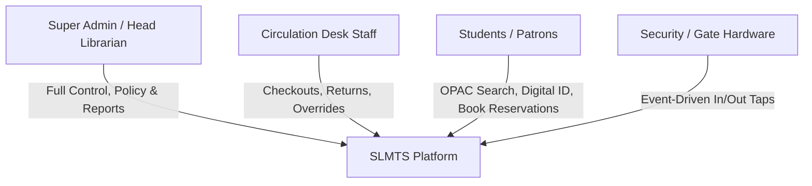
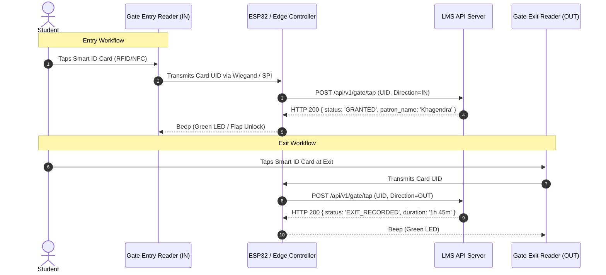
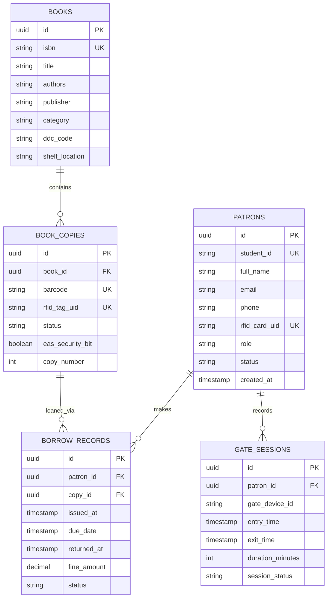

# Product Requirement Document (PRD)
## Smart Library Management & Tracking System (SLMTS)
**Version:** 1.0.0  
**Status:** Approved for Implementation  
**Target Platform:** Web Application (Responsive Desktop / Tablet / Mobile) + IoT Gate/Desk Edge Devices  

---

## 1. Executive Summary & Vision

### 1.1 Problem Statement
Traditional libraries rely heavily on manual barcode scanning, physical registers, or legacy software (like raw Koha installations) that require significant manual intervention. Key pain points include:
* **Manual Circulation Delays:** Staff scan barcodes one-by-one, leading to queues at peak hours.
* **Lack of Footfall & Time Analytics:** Libraries record attendance manually or not at all; there is no real-time visibility into current occupancy or student dwell time.
* **Privacy & Cost Concerns with AI Cameras:** Facial recognition systems raise severe privacy objections among students, suffer from lighting/angle failures, and require expensive GPU servers.
* **Book Misplacement & Unauthorized Removal:** Optical barcodes require line-of-sight and cannot trigger automated anti-theft gate alarms reliably.

### 1.2 Product Vision
The **Smart Library Management & Tracking System (SLMTS)** delivers a modern, web-first Library Management System (LMS) inspired by Koha’s battle-tested circulation rules, but upgraded with:
1. **Zero-AI, Privacy-Preserving Gate Tracking:** Dual RFID/NFC card readers at gates to track entry, exit, live occupancy, and time spent.
2. **Multi-Book HF RFID Circulation:** Counter/kiosk pads capable of reading stacked books simultaneously without line-of-sight.
3. **EAS Anti-Theft Gates:** Automated security bit verification at exit points to stop unissued books.

---

## 2. User Personas & Roles



| Role | Access Level | Key Capabilities |
| :--- | :--- | :--- |
| **Super Admin** | System-wide | Configure circulation rules, fine rates, branch libraries, hardware edge keys, role permissions. |
| **Librarian / Staff** | Operational | Catalog books, encode RFID tags, issue/return books, collect fines, view live student occupancy. |
| **Student / Patron** | Self-service | Search OPAC, view active loans, renew books, reserve titles, view personal library study hours. |
| **Hardware Service** | Machine-to-Machine | ESP32/Edge microcontrollers publishing gate scans and kiosk events via authenticated API/MQTT. |

---

## 3. Hardware Architecture (Non-Camera Approach)



### 3.1 Hardware Specifications
1. **Patron Smart Card Reader (Gate In & Out):**
   * **Frequency:** 13.56 MHz (Mifare Classic 1K / DesFire) or 125 kHz EM4100 / UHF.
   * **Controller:** ESP32-WROOM-32 with Ethernet/Wi-Fi + RC522 / PN532 or Wiegand-26/34 Industrial Wall Reader.
   * **Feedback:** Bi-color LED (Green/Red) and piezo buzzer (100ms chirp for grant, 3 beeps for deny).
2. **Book Circulation RFID Reader (Desk / Kiosk):**
   * **Standard:** ISO 15693 / ISO 28560 (Standard Library HF RFID).
   * **Read Range:** 15–25 cm (reads up to 5 books stacked on a flat pad).
   * **Connection:** USB HID / Virtual COM port to PC or WebUSB / Web Serial API directly inside Chrome/Edge.
3. **Anti-Theft EAS Security Pedestal:**
   * Installed at library exit gate. Scans ISO 15693 EAS/AFI security byte.
   * If bit is active (book not checked out), triggers audible 85dB alarm and red beacon strobe.

---

## 4. Functional Requirements

### Module 1: Cataloging & Book Management (Koha Inspired)
* **FR-1.1:** Support standard book attributes: Title, Authors, ISBN-10/13, Publisher, Edition, Year, DDC (Dewey Decimal), Shelf/Rack Location, Total Copies.
* **FR-1.2:** Auto-fetch bibliographic metadata via OpenLibrary / Google Books API upon entering ISBN.
* **FR-1.3:** Individual copy tracking: Each copy has a unique Barcode and a bonded `rfid_tag_uid`.
* **FR-1.4:** Tag Encoding Utility: Web interface to bind an unassigned RFID book sticker to a book copy with 1 click.

### Module 2: Patron & Identity Management
* **FR-2.1:** User directory supporting Student ID, Department, Batch, Phone, Email, and status (Active/Suspended).
* **FR-2.2:** Smart Card Binding: Ability to tap an ID card on the desk reader to associate its UID with the student profile.
* **FR-2.3:** Borrowing Quota Rules:
  * Undergraduate: Max 4 books, 14 days loan period.
  * Postgraduate: Max 8 books, 30 days loan period.
  * Faculty: Max 15 books, 90 days loan period.

### Module 3: Circulation Engine
* **FR-3.1:** **Single/Multi-Book Issue:** Patron card read + Book RFID tag(s) read -> validates limits -> writes loan records -> sets EAS security bit to `INACTIVE`.
* **FR-3.2:** **Instant Return:** Book placed on return pad -> system detects book copy -> marks returned -> checks overdue fines -> sets EAS security bit to `ACTIVE`.
* **FR-3.3:** **Automated Fine Calculator:** Daily cron or on-return trigger calculating fine based on customizable daily rate (e.g. ₹2/day after grace period).

### Module 4: Gate Access & Occupancy Tracking
* **FR-4.1:** **Tap-In Logic:**
  * Checks if patron is already marked `INSIDE`. If not, creates `gate_sessions` record with `entry_time = NOW()`.
  * Increments live library occupancy counter.
* **FR-4.2:** **Tap-Out Logic:**
  * Matches active open session, records `exit_time = NOW()`.
  * Computes total dwell duration in minutes (`exit_time - entry_time`).
  * Decrements live occupancy counter.
* **FR-4.3:** **Offline Resilience:** If network drops, ESP32 buffers up to 1,000 taps in local SPIFFS flash with NTP timestamps and flushes upon reconnecting.

### Module 5: OPAC & Student Portal
* **FR-5.1:** Responsive public search catalog with filters (Author, Category, Availability).
* **FR-5.2:** Shelf locator indicator (e.g. "Rack B, Shelf 3").
* **FR-5.3:** Student Dashboard: View current loans, due dates, calculated fines, and personal study hour logs.

### Module 6: Analytics & Administrative Reports
* **FR-6.1:** Real-time occupancy gauge on Admin Dashboard (e.g. "68 / 150 Seats Occupied").
* **FR-6.2:** Hourly and daily footfall graphs (peak study hours).
* **FR-6.3:** Student study time leaderboard / monthly attendance report for academic credits.
* **FR-6.4:** Overdue and lost book audit reports.

---

## 5. Database Schema Blueprint



---

## 6. API Specifications (Sample Endpoints)

### 6.1 Hardware Edge Endpoints

#### `POST /api/v1/gate/tap`
Payload sent by ESP32/Reader:
```json
{
  "device_id": "GATE_ENTRY_01",
  "card_uid": "E28011702000208169A1B2C3",
  "direction": "IN",
  "timestamp": 1728300000
}
```
Response:
```json
{
  "status": "SUCCESS",
  "action": "ACCESS_GRANTED",
  "patron": {
    "name": "Khagendra Singh",
    "student_id": "STU2026-081"
  },
  "current_occupancy": 42
}
```

#### `POST /api/v1/circulation/scan-pad`
Payload sent when books are laid on RFID pad:
```json
{
  "reader_id": "DESK_PAD_01",
  "patron_card_uid": "E28011702000208169A1B2C3",
  "book_tag_uids": [
    "E004010045612341",
    "E004010045612342"
  ],
  "action": "ISSUE"
}
```

---

## 7. Implementation Roadmap & Milestones

| Milestone | Target Deliverable | Duration |
| :--- | :--- | :--- |
| **Milestone 1** | Project setup (Next.js + Prisma + SQLite/PostgreSQL) & Database Migrations | Days 1–3 |
| **Milestone 2** | Cataloging & Patron Management Modules with Web UI | Days 4–7 |
| **Milestone 3** | Circulation Engine (Issue/Return logic, fine calculator) | Days 8–11 |
| **Milestone 4** | Gate In/Out API + Virtual Web Hardware Simulator (Test without physical reader) | Days 12–14 |
| **Milestone 5** | ESP32 Firmware & WebUSB/Serial RFID Desk Reader Integration | Days 15–18 |
| **Milestone 6** | Real-time Occupancy Dashboard, Analytics & Reporting | Days 19–21 |

---

## 8. Success Metrics (KPIs)
* **Gate Transit Speed:** Card tap to visual confirmation under **400 ms**.
* **Circulation Throughput:** 5 stacked books checked out in under **3 seconds** (vs 45 seconds manual barcode scan).
* **Inventory Accuracy:** Real-time visibility of book availability across all racks.
* **Attendance Completeness:** 100% automated logging of student visits without human registers or intrusive AI surveillance.
